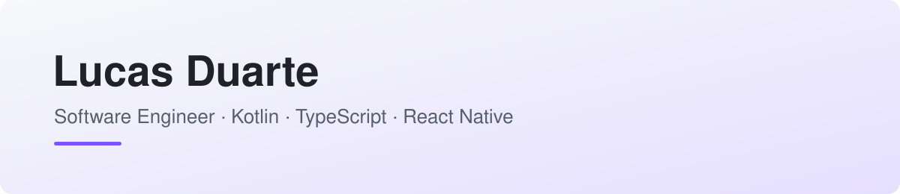

<picture>
  <source media="(prefers-color-scheme: dark)" srcset="assets/banner-dark.svg">
  
</picture>

 

  
  
  

I'm a **Mobile Software Engineer at [Neon](https://neon.com.br)**, one of Brazil's largest digital banks, with **7+ years** building high-scale financial software. 

Day-to-day, I lead the modernization of native **Android** platforms using **Kotlin** and **Jetpack Compose**, alongside building cross-platform solutions with **React Native**, **TypeScript**, and **Backend-for-Frontend (BFF)** architectures.

- 🤖 **Android Native**: Kotlin, Jetpack Compose, MVI / MVVM, Coroutines & Flow, Hilt, JUnit, Mockito
- 📱 **Cross-Platform & Web**: React Native, Expo, TypeScript, Redux Toolkit, Styled Components, Storybook
- ⚙️ **Platform & Backend**: Backend-for-Frontend (BFF), Kong Gateway, REST APIs, Design Systems
- 📊 **Observability & Experimentation**: Mixpanel, Datadog, Firebase (Crashlytics/Analytics), GrowthBook
- 🧱 **Design Systems**: Reusable, themeable, and accessible UI component libraries

 

## 📌 Featured projects

### Design System · React Native

A reusable UI component library for React Native apps, built with TypeScript, Expo, and Storybook, ensuring shared consistency, accessibility, and themeability across mobile platforms.

`React Native` `Expo` `TypeScript` `Design System` `Storybook` `Jest`

**[View repository →](https://github.com/lucasvduarte/desing-system-RN)**

 

### Micro-business App · Full stack

A small business management application, divided into a React frontend and a REST API backend, fully containerized with Docker for deployment.

`React` `TypeScript` `Tailwind CSS` `Node.js` `Docker` `REST API`

**[Frontend →](https://github.com/lucasvduarte/micro-empreendimento-front)** · **[Backend →](https://github.com/lucasvduarte/micro-empreendimento-back)**

 

### Table Component · React

A lightweight, highly customizable table component for rendering complex datasets in React applications.

`React` `TypeScript` `UI Component` `Frontend`

**[View repository →](https://github.com/lucasvduarte/table)**

 

## 🛠️ Tech stack

**Android Native & Mobile**

**Web, Back end & Platform**

**Tools & Testing**

 

## 🧩 Academic & Studies

| What it is | Stack |
|---|---|---|
| Computer Science university labs on data structures and algorithms (UFCG) | Java |

 

Thanks for stopping by! ✨

